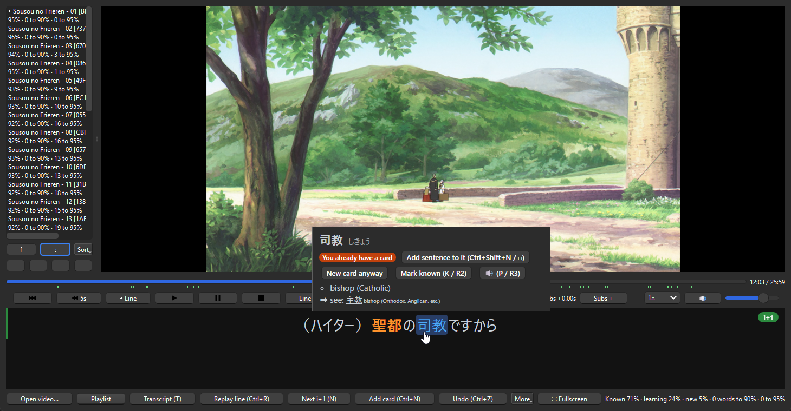

# Ankime

Ankime is an Anki add-on for learning Japanese by watching anime. You get a video player with clickable subtitles, you look words up without leaving the episode, and when a line is worth keeping you press one key and it becomes a card, audio and screenshot included.

What it does:

- **Subtitles that know what you know.** Words are coloured as new, learning or known, based on the cards already in your collection. You can turn on furigana just for the words you don't know yet, and hovering a word shows its dictionary entry.
- **One key to mine.** Ctrl+N makes a sentence card with the line's audio and a frame from the video. Ctrl+Shift+N makes a word card with reading, definition, pitch accent, frequency and audio. If you already have a card for that word, the new sentence gets added to it instead of creating a duplicate.
- **i+1 made easy.** Ankime spots lines with exactly one new word (names don't count). It can skip lines you already fully understand, pause on i+1 lines for you, or just hop from one i+1 line to the next across a whole season.
- **Search your library** (Ctrl+F). Ever wonder where else you heard a word? This finds every line containing it across all the episodes you've watched, i+1 lines first. Double-click one to replay it.
- **Pick what to watch next.** The playlist shows how much of each episode you'd understand, and how many words you'd need to learn to hit 90% or 95%. Sort by best coverage and the easiest episodes float to the top.
- **A transcript panel** with every line of the episode and its new words, sorted by how often they come up. Click to play a line, right-click to mine it, or add a bunch of words in one go.
- **Whole-episode tools.** Make a card for every line (or every i+1 line) in one go, and undo it all just as easily if you change your mind. You can also save condensed audio, just the spoken parts, to listen to on the go.
- **YouTube and other sites.** Paste a link and Ankime plays it through [yt-dlp](https://github.com/yt-dlp/yt-dlp), subtitles and all, and you can mine from it just like a local file.
- **Immersion log.** Tracks how long you watched and how many cards you made each day, with a daily goal, a streak, a graph of your known words over time, and a breakdown by show.
- **Bring your vocabulary with you.** Import known words from a plain list, JPDB or Migaku, and export them again whenever you like. Known words, subtitle delays and your log all sync through AnkiWeb.
- **Gamepad support**, so you can do all of this from the couch (see [Gamepad](#gamepad)).

It's Japanese only for now: word splitting, particles and known-word matching are all built around Japanese.

**Contents**

- Part 1 — Quick start: [Requirements](#requirements) · [Setup](#setup) · [Your first card](#your-first-card) · [Default keys](#default-keys)
- Part 2 — In depth: [Features](#features) · [Settings reference](#settings-reference) · [Limitations](#limitations) · [Troubleshooting](#troubleshooting)
- [Development](#development)

# Part 1 — Quick start

## Requirements

- Anki 2.1.50 or newer, on Windows, macOS or Linux (X11 or Wayland).
- **libmpv**, which does the actual video playback.
  - Windows: you don't need to do anything, **Test setup** (or **Download...** on the Media tab in settings) grabs it for you. If you'd rather do it yourself, download `mpv-dev-x86_64-….7z` from [sourceforge.net/projects/mpv-player-windows/files/libmpv](https://sourceforge.net/projects/mpv-player-windows/files/libmpv/), unpack it, and point Ankime at the folder with `libmpv-2.dll` in it.
  - macOS: `brew install mpv`. Ankime will find it on its own.
  - Linux: install it from your package manager (`sudo apt install libmpv2`, `sudo dnf install mpv-libs`, etc.).
- **ffmpeg**, used to cut the audio clips and screenshots for your cards. On Windows it's downloaded for you, same as libmpv. Otherwise get it from [ffmpeg.org](https://ffmpeg.org/download.html) and either put it on your PATH or tell Ankime where it is.
- **A dictionary.** You've got two options:
  - **Ankime's built-in dictionaries.** Go to **Tools > Ankime > Dictionaries...** and download JMdict with one click, or import any Yomitan dictionary (.zip). Nothing else needs to be running, but you won't get word audio this way.
  - **Yomitan** in your browser, with some Japanese dictionaries and **[yomitan-api](https://github.com/yomidevs/yomitan-api)** installed (and "Enable Yomitan API" ticked in Yomitan's settings). Your browser needs to stay open while you watch, but you get word audio from Yomitan's audio sources.
- Optional: **[yt-dlp](https://github.com/yt-dlp/yt-dlp)** on your PATH if you want to watch YouTube and other sites. Keep it updated (`yt-dlp -U`), since sites change all the time and old versions stop working.

## Setup

1. Install the add-on and restart Anki.
2. The **setup wizard** pops up on its own. Just click through it. It'll set up a note type (or reuse the one you already mine into; Lapis, JP Mining Note, Kiku, Senren and Kaishi 1.5k are recognised and filled in automatically), pick a deck, count the words from your existing cards as known, choose a dictionary, and check that libmpv and ffmpeg are working (downloading them for you on Windows). You can run it again any time from **Tools > Ankime > Setup wizard...**
3. Everything the wizard set up lives in **Tools > Ankime > Settings**. If something seems off, hit **Test setup** there: it checks everything again, tells you what's missing, and fixes what it can.
4. Prefer to set things up yourself? Cancel the wizard, open the settings, click **Create Ankime note type** (or choose your note type under **Preset**), then set ffmpeg and the libmpv folder on the **Media** tab.
5. Open **Tools > Ankime > Player...** and open a video, or just drag videos or a whole folder onto the window.

## Your first card

1. Put your subtitles next to the video with the same name: `ep01.ja.srt` for Japanese, plus `ep01.en.srt` if you want a translation too. Don't have any? Try **More > Search Jimaku...** (more on that in [Subtitles](#subtitles-finding-loading-and-syncing)).
2. Press **Space** to play and **A / D** to jump between lines.
3. When you hit a line you like, press **Ctrl+N**. That's it, you've got a sentence card with audio and a screenshot.
4. Want just one word? Select it with **Shift+Left / Right** (or hover over it) and press **Ctrl+Shift+N**.
5. Made a mistake? **Ctrl+Z** undoes the card, and **Ctrl+E** opens it in the browser so you can edit it.

## Default keys

| Key | Action | Key | Action |
|---|---|---|---|
| Ctrl+N | Add sentence card | Space | Play / pause |
| Ctrl+Shift+N | Add card for the selected word | Left / Right | Rewind / forward |
| Ctrl+Z | Undo | A / D | Previous / next line |
| Ctrl+E | Edit the last card | Ctrl+R | Replay line |
| C | Copy the line | | |
| K | Mark the selected word known | L | Loop line |
| P | Play the selected word's audio | N | Next i+1 line |
| Shift+Left / Right | Select previous / next word | T | Transcript |
| Ctrl+Up / Down | Card takes the previous / next line too | Ctrl+T | Translation hidden / blurred / shown |
| Z / X | Subtitles earlier / later | F | Fullscreen |
| Shift+Z | Sync: the nearest line starts now | Ctrl+F | Search your library |

All of them can be changed on the settings' **Hotkeys** tab (see [Hotkeys](#hotkeys-tab) for every action). A gamepad works too: see [Gamepad](#gamepad).

# Part 2 — In depth

## Features

All of this happens in the player (**Tools > Ankime > Player...**). Most of the extra stuff is tucked away in its **More** menu.

### Playing videos and the playlist

- Open a video, or drop videos or a whole folder on the player window to add them to the playlist.
- **More > Open URL...** plays a video from YouTube or another site yt-dlp supports (an address on the clipboard is filled in). It needs yt-dlp on your PATH. Its subtitles are fetched in the source language (and the target language, if you use translations): the site's own, else its automatic captions; **Load subtitles...** picks a file instead. Cards and condensed audio work as with a file; Jimaku search and aligning don't (they need the video on your computer). The playlist shows the video's title and remembers where you stopped.
- **Ctrl+Left / Ctrl+Right** move through the playlist. Ankime remembers where you stopped in each video.
- Playback speed goes from 0.5× to 2× (**[** / **]**, **Backspace** resets) and the pitch stays the same. Volume: **9** / **0**, **M** to mute, or the mouse wheel over the video.
- **F** or a double-click on the video toggles fullscreen. **Esc** closes the word popup first, then leaves fullscreen. It never closes the player.
- The player remembers its volume, speed and panel widths between sessions.

### Subtitles: finding, loading and syncing

Ankime finds subtitles next to the video by name. Tags in the file name set the language.

| File | Read as |
|---|---|
| `ep01.ja.srt` / `ep01.jpn.srt` | Japanese (source) |
| `ep01.en.srt` / `ep01.eng.srt` | Translation (target) |
| `ep01.srt` (no tag) | Japanese |
| Embedded text track | Matched by its language |

- **More > Load subtitles...** picks any file by hand (a `Subs` folder, an odd name). The choice is remembered for that video.
- **More > Search Jimaku...** searches [Jimaku](https://jimaku.cc) using the show's folder name and the episode number in the file name. The file is saved next to the video as `ep01.ja.srt`, never over an existing file (it becomes `ep01.ja.jimaku.srt` instead). .zip archives are unpacked. It needs a free Jimaku account: generate an API key on its account page and enter it in **Ankime Settings > Player**.
- **Manual sync**: **Z / X** shift the subtitles earlier / later by one step. **Shift+Z** as you hear a line begin makes the nearest line start right then. For subtitles too far off, right-click a line in the transcript and pick **Sync subtitles: this line starts now**.
- **Automatic alignment**: install [alass](https://github.com/kaegi/alass) or [ffsubsync](https://github.com/smacke/ffsubsync) and set it as the **Subtitle aligner**. Jimaku downloads are then offered alignment, and **More > Align subtitles to the audio** aligns any file. The result is saved as `ep01.ja.synced.srt`.
- **Subtitles from speech**: for shows with no Japanese subtitles on Jimaku, install [faster-whisper](https://github.com/Purfview/whisper-standalone-win) (Faster-Whisper-XXL or whisper-ctranslate2) or [whisper.cpp](https://github.com/ggml-org/whisper.cpp) (`whisper-cli` plus a multilingual ggml model) and set it as the **Transcriber**. **More > Generate subtitles from speech** (or **Generate from speech** in the Jimaku search) transcribes the audio track playing and saves `ep01.ja.whisper.srt`. A GPU makes it take minutes; on a CPU it can take longer than the episode. Speech recognition makes mistakes, so check a line against the audio before mining it.
- The subtitle delay is remembered per folder (`Show` or `Show/Season 1`) and syncs to your other computers.

### Word colours and known words

Each word in a line gets one of three statuses, read from your cards:

| Status | Rule | Default look |
|---|---|---|
| New | No card, not marked known | Orange, bold |
| Learning | Strongest card's interval is under **Known interval** (21 days) | Blue |
| Known | Strongest card's interval is at least 21 days, or marked known | Plain |

- With FSRS on, card stability is used instead of the interval.
- Particles and the copula (は, が, だ, です...) are never "new". Words with no dictionary entry (mostly names) stay uncoloured and don't count, unless you mark them known.
- A card also covers other spellings and the reading of its word: a card for 綺麗 makes 奇麗 and きれい known too.
- **K** marks the selected word known. **Shift+K** marks every new word of the line known.
- Cards of other note types can count too (**Also count**), and so can every word of a known sentence card (**Known sentence words**). See the [Lookup tab](#lookup-tab).
- In Anki's browser, **Notes > Ankime: Mark every new word of the sentence known** does it for the selected notes. Yomitan must be running.

### Looking up words

- Words are looked up in Yomitan (through yomitan-api) or in **Ankime's own dictionaries** (settings' Lookup tab, **Dictionary**). See [Ankime's own dictionaries](#ankimes-own-dictionaries).
- Hover a word, or move with **Shift+Left / Right** (left stick on a gamepad), to open its dictionary entry from Yomitan.
- The popup shows every dictionary entry. Its buttons add a card from any of them. **P** plays the word's audio.
- **Furigana** can be shown over new words, new + learning words, all words, or none.
- **Pitch accent** (Player tab) colours each word by its pitch-accent category: heiban, atamadaka, nakadaka, odaka or kifuku, either over its own colour or as a coloured line under it that keeps the new / learning colours. It needs a pitch-accent dictionary in Yomitan (or Ankime's own); the colours can be changed.
- **Pause while a word's definition is open** pauses playback during lookups and resumes when the popup closes.
- **Definition size** (Player tab) sets the popup's text size, or **Follow the subtitle size** keeps it in proportion to the subtitles; the popup grows with it. It also grows with the subtitles' zoom (Ctrl+wheel over them) and in fullscreen, like the subtitles, for a TV across the room.
- **C** copies the line (with any extra lines the card takes) to paste into a translator.

### Ankime's own dictionaries

**Tools > Ankime > Dictionaries...** (or **Dictionaries...** on the settings' Lookup tab) manages dictionaries Ankime reads by itself, so no browser has to be open.

- **Download JMdict (English)** fetches the latest [JMdict for Yomitan](https://github.com/yomidevs/jmdict-yomitan) (about 16 MB), checks it against the SHA-256 GitHub publishes, and imports it.
- **Import a dictionary...** takes any Yomitan dictionary .zip (format 3, what Yomitan has used since 2019): Jitendex, frequency lists such as JPDB's (they fill the frequency field and sort the transcript), pitch accents such as Kanjium's (the pitch field).
- After the first import, Ankime offers to use them instead of Yomitan; **Settings > Lookup > Dictionary** switches either way. Each choice keeps its own analyses, so switching back is instant.
- Lines are split like Yomitan's scanning parser: the longest dictionary word at each point, through conjugations (書かれなかった is 書く). With MeCab installed, MeCab's split is used as with Yomitan.
- Pictures in dictionaries aren't imported, and there is no word audio (that comes from Yomitan's audio sources).
- The dictionaries are kept in `user_files/dictionaries.sqlite` (about 135 MB with JMdict).

### Mining cards

- **Sentence card** (**Ctrl+N**): the line, its audio (with padding, normalised loudness) and a picture. The picture is the frame on screen if you paused within the line, otherwise the middle of the line.
- **Word card** (**Ctrl+Shift+N**): uses the first dictionary entry for the selected word. Fills word, reading, definition, pitch accent, frequency and word audio, plus the sentence fields.
- **Review before adding** (Cards tab): the card opens in Anki's Add window, filled in, so you can trim the sentence or keep one definition before adding it. The video pauses meanwhile; Undo and Edit work on it once added.
- **Already have a card for that word?** Ankime adds the sentence to the existing card instead of making a duplicate.
- **Multi-line cards**: **Ctrl+Up / Ctrl+Down** extend the card to the previous / next line. With **Whole sentence** on, a sentence split across up to 3 lines is taken whole automatically.
- **Undo** (**Ctrl+Z**) removes the last card, sentence added to a card, or words marked known. Press again for the one before, up to 20 steps. A whole batch undoes in one step.
- **Edit** (**Ctrl+E**) opens the last card in Anki's browser.
- Cards are tagged with your tags and, by default, `ankime::Show` (or `ankime::Show::Season_1`).

### i+1 lines and line filters

An i+1 line has exactly one new word. Learning words and names don't count as new.

| Line filter | What plays |
|---|---|
| Off | Everything |
| Skip known | Jumps over lines with no new word |
| Only i+1 | Only lines with exactly one new word |
| Jump i+1 to i+1 | Goes straight from one i+1 line to the next, skipping the gaps too; continues into the next playlist episode |

- **N** jumps to the next i+1 line in any mode. The seek bar marks i+1 lines and the cards you added.
- **Auto pause** can stop *before* an i+1 line (to read it first), *after* it plays, or after *every* line. Replaying a line re-arms the after / every pause.
- A line you click in the transcript or play from library search always plays, whatever the filter.
- The filter needs the episode's subtitles to be analysed, so the first lines may play until then.

### Transcript (T)

- Lists every line of the episode. Click a line to play it. Right-click to mine it, copy it, mark its words known, or sync from it.
- Lists the episode's new words, sorted by how often they appear in the episode or how common they are in Japanese. Add several as a batch; **Undo** removes the whole batch.

### Library search (Ctrl+F)

Type a word (or select one in the subtitles) and you'll see every line it appears in, across every episode Ankime has analysed so far. i+1 lines are listed first. Double-click a result to jump straight to it.

### Episode planning

Next to each episode in the playlist you'll see how many of its words you already know, and how many more you'd need to learn to reach 90% or 95% coverage. Use **Sort > Best coverage first** to put the easiest episodes at the top.

### Whole-episode tools

- **More > Add a card for every line**: one sentence card per line, per i+1 line (new word bolded), or per line with a new word. The menu shows how many cards each choice makes. Lines already added this session are skipped. Undo removes them all at once.
- **More > Save condensed audio...**: saves the episode's audio with only the subtitled lines, for listening without the video.

### Importing and exporting known words

**More > Mark known from a word list...** (or **Tools > Ankime > Known words**, without the player) reads:

| Source | What becomes known |
|---|---|
| JPDB review history (`vocabulary-reviews.json`) | Words set aside as known, and words whose last review passed at least Known interval days after the previous one |
| Migaku export (CSV / JSON) | Only words with status KNOWN |
| Plain list | One word per line, or the first Japanese column of a TSV / CSV (or a column headed `word`) |

**Export known words...** saves all known words, or only those marked known (as a backup). Formats: Ankime's list, or a bare list for JPDB or Migaku. Undo takes an import back.

### Immersion log

Open it from **More > Immersion log...**. There are three tabs:

- **Days**: how long you watched and how many cards you mined each day over the last 30 days, along with your daily goal and streak. You only need to watch for a minute for a day to count towards the streak. Days roll over when Anki's do (4 am by default), so a late-night session still counts for the evening before.
- **Known words**: a graph of how many words you knew at the end of each day (hover the line to see a day's count), with the days it changed listed below. It's rebuilt from what your collection already has, Anki's review log and the words you've marked known, so it goes back further than when you installed Ankime. Words count the same way they do in the player. With FSRS, past days use the cards' intervals at the time and today uses their stability.
- **Shows**: how many cards you've mined from each show, based on the `ankime::` tags.

### Gamepad

Just plug in a controller and it works whenever the player window is focused. The default layout:

| Button | Action | Button | Action |
|---|---|---|---|
| Left stick ← / → | Previous / next word (opens its definition) | A | Add sentence card |
| Left stick ↑ / ↓ | Card takes the previous / next line too | X | Add card for the selected word |
| Right stick ↑ / ↓ | Scroll the definition | Y | Show / hide the definition |
| D-pad ← / → | Previous / next line | B | Close the definition / leave fullscreen |
| D-pad ↑ | Replay line | D-pad ↓ | Next i+1 line |
| LB / RB | Rewind / forward | LT | Undo |
| RT | Mark the selected word known | Start / Back | Play / pause, fullscreen |
| Left stick press | Loop line | Right stick press | Play the word's audio |

On a PlayStation controller, A is ✕, B ○, X □, Y △, LB L1 and so on. Held down, moving through the words, scrolling the definition, the volume and the subtitle delay repeat. To remap buttons, see the [Gamepad tab](#gamepad-tab).

### What syncs between computers

| Syncs through AnkiWeb | Stays on this computer |
|---|---|
| Words marked known | Playlist and resume positions |
| Subtitle delays | Tokenisation and frequency caches |
| Immersion log | Volume, speed, panel widths (`state.json`) |
| | Ankime's own dictionaries, and libmpv / ffmpeg if Ankime downloaded them |

Each computer writes its own entry and they are merged when read, so changes made on two computers between syncs are all kept.

## Settings reference

All settings are in **Tools > Ankime > Settings**, on six tabs. **Advanced (JSON)...** opens every key in a text editor, with [config.md](config.md) beside it. Only the settings you change are saved; the rest follow the defaults, even when a new version changes them.

Changes apply at once, even in an open player, except:

- **libmpv folder** and **Video output**: the next time the player opens.
- **Source / Target language** and **Translation field**: the next video you open.

### Cards tab

| Setting (JSON key) | Default | What it does |
|---|---|---|
| Deck (`deck`) | Default | Deck for new cards |
| Note type (`note_type`) | Basic | Note type for new cards. **Create Ankime note type** adds one with a field for everything |
| Preset | — | Fills every field for Lapis, JP Mining Note, Kiku, Senren or Kaishi 1.5k. Fields the note type lacks are left blank. Also counts your recognised note types towards known words |
| Sentence field (`sentence_field`) | Front | The line(s) |
| Sentence furigana (`sentence_furigana_field`) | "" | Sentence in Anki's furigana format, `日本語[にほんご]を 勉強[べんきょう]する`, for `{{furigana:Field}}` |
| Context (`context_field`) | "" | The line before the card's |
| Audio / Picture (`audio_field`, `image_field`) | "" | Line audio and picture |
| Word, Reading, Definition, Pitch, Frequency, Word audio (`word_field` ... `word_audio_field`) | Definition = Back, others "" | Filled on word cards. **`word_field` also drives known-word detection**: without it, only words marked known count |
| Key (`key_field`) | "" | The word a second time (JP Mining Note's Key) |
| Translation (`translation_field`) | "" | The target-language subtitle |
| Source (`source_field`) | "" | "Show · episode · 12:34" |
| Definition (`definition_marker`) | glossary-brief | Short definitions, or `glossary` for every dictionary, with its images |
| Bold the word (`bold_word`) | on | Bolds the mined word in the sentence |
| Review before adding (`review_before_adding`) | off | Opens each card in Anki's Add window, filled in, instead of adding it at once (not batches or whole-episode extraction) |
| Tags (`tags`) | anime | Added to every card, separated by spaces |
| Tag with show (`show_tag`) | on | Adds `ankime::Show`. The immersion log's Shows tab needs it |

A field set to "" is skipped. A field name the note type doesn't have is an error.

### Media tab

| Setting (JSON key) | Default | What it does |
|---|---|---|
| Audio padding (`audio_padding`) | 0.2 s | Extra audio before and after the line |
| Normalize (`normalize_audio`) | on | Brings clips to −16 LUFS (EBU R128), one fixed gain per clip, at most +20 dB, never clipping |
| Audio format (`audio_format`) | m4a | `m4a`, `mp3` or `opus`. Opus is the smallest, but AnkiMobile before iOS 17 can't play it. mp3 / opus need an ffmpeg with libmp3lame / libopus |
| Picture format (`image_format`) | webp | `webp` or `jpg`. Falls back to JPEG if ffmpeg lacks libwebp |
| Picture max height (`image_height`) | 480 px | Taller pictures are scaled down. 0 = original size |
| Animated picture (`animated_image`) | off | `webp` or `avif`: a silent loop at 10 fps, up to 8 s around the picture's time. AVIF is smaller but slower to make, needs libaom-av1 and a recent Anki on every device. Falls back to a still picture if ffmpeg fails |
| ffmpeg (`ffmpeg_path`) | ffmpeg | Full path, or `ffmpeg` if it's on PATH |
| libmpv folder (`mpv_dll_dir`) | "" | Folder with `libmpv-2.dll`. Not needed for Homebrew on macOS or packages on Linux |
| Video output (`video_output`) | auto | `auto` (OpenGL, native window as fallback), `opengl`, or `window` (Windows / X11 only; try it if the video stays black) |

### Player tab

| Setting (JSON key) | Default | What it does |
|---|---|---|
| Rewind / forward (`seek_seconds`) | 5 s | Jump size |
| Source / Target language (`source_lang`, `target_lang`) | ja / en | Language codes used to match subtitle files and tracks |
| Subtitle delay step (`sub_delay_step`) | 0.1 s | Shift per Z / X press |
| Whole sentence (`merge_split_lines`) | on | Joins up to 3 lines ending in 、 , → or は が を に へ で や, if the next follows within 1 s without overlapping |
| Jimaku API key (`jimaku_api_key`) | "" | From your jimaku.cc account page |
| Subtitle aligner (`sub_sync_tool`) | "" | Path to `alass-cli` or ffsubsync. Uses your ffmpeg |
| Transcriber (`transcriber`) | "" | Path to faster-whisper (Faster-Whisper-XXL, whisper-ctranslate2) or `whisper-cli`, to make subtitles from the speech. Uses your ffmpeg |
| Transcriber model (`transcriber_model`) | "" | faster-whisper: a model name (`large-v3`); whisper.cpp: a ggml model file ("" = the largest next to `whisper-cli`) |
| Line filter (`line_filter`) | off | `off`, `skip_known`, `only_i1`, `i1_jump` |
| Auto pause (`i1_pause`) | off | `off`, `before`, `after`, `every` |
| Subtitle size (`subtitle_font_size`) | 28 px | A fifth larger in fullscreen |
| New / Learning / Known words (`new_word_style`, ...) | see below | Look of each status |
| Furigana (`furigana`) | new | `off`, `new`, `unknown` (new + learning), `all` |
| Pitch accent (`pitch_display`) | off | `off`, `color` (the word takes its pitch-accent category's colour), `line` (a coloured line under it) |
| Pitch colours (`pitch_colors`) | "" each | `"#rrggbb"` per category (`heiban`, `atamadaka`, `nakadaka`, `odaka`, `kifuku`), "" for blue, red, orange, green, purple |
| Translation (`translation_display`) | off | `off`, `blur` (until hovered), `on` |
| Definition size (`popup_font_size`) | 15 px | Text size of the word popup (10–40, or 0 to follow the subtitle size); the popup grows with it, and with the subtitles' zoom and fullscreen |
| Daily goal (`daily_goal_minutes`) | 0 (no goal) | Minutes per day, for the log and streak |
| Pause on lookup (`pause_on_lookup`) | off | Pause while a definition is open |

**Word styles** each have `color` and `background` (`"#rrggbb"`, or `""` for Ankime's colours, lighter in night mode and fullscreen), `bold`, `italic`, `underline` (`none`, `solid`, `dotted`, `dashed`, `wavy`, `double`) and `size` (50–200 % of the subtitle size). A colour you pick is used in every theme. For colour-blind users, an underline, bold or a size tells the statuses apart without colour. The dropdown under them sets all three at once: **Default**, or a colour-blind preset that keeps the colours and adds underlines (solid for new words, dotted for learning ones), wavy and dashed lines, or larger new words.

### Lookup tab

| Setting (JSON key) | Default | What it does |
|---|---|---|
| Dictionary (`dictionary`) | yomitan | `yomitan` (yomitan-api in your browser) or `local` ([Ankime's own dictionaries](#ankimes-own-dictionaries)) |
| Yomitan API URL (`yomitan_url`) | http://127.0.0.1:19633 | yomitan-api address. When it stops answering, Ankime retries, waiting longer each time (up to a minute) |
| Scan length (`scan_length`) | 20 | Longest word, in characters, Yomitan tries |
| Parser (`parser`) | auto | `auto` uses MeCab if found, else Yomitan's parser; `yomitan` always uses Yomitan's |
| Known interval (`known_interval`) | 21 days | Interval (or FSRS stability) at which a word becomes known |
| Count suspended (`count_suspended`) | off | Whether suspended cards count towards known and learning words |
| Also count (`vocab_sources`) | [] | Other note types and their word field, e.g. `[{"note_type": "Core 2k", "word_field": "Vocab"}]` |
| Known sentence words (`sentence_words`) | off | Every word of a known sentence card becomes known |
| Sentence cards (`sentence_sources`) | [] | Extra sentence note types, e.g. `[{"note_type": "Kaishi 1.5k", "sentence_field": "Sentence"}]` |

**Choosing a parser.** Yomitan's parser takes the longest dictionary word at each point, so 探さないといけません can split into 探さない|とい|け|ません. MeCab analyses the grammar (と|いけません), and Ankime keeps Yomitan's longer words where they agree (あの子, しょうがない stay whole). Ankime doesn't bring MeCab: it uses the one of another add-on (ankimorphs-japanese-mecab, Japanese Support...) or one on the PATH, with the IPAdic dictionary. **Test setup** says whether one is found. Each parser's splits are cached apart.

**Word fields** may hold several words separated by commas, 、 or line breaks ("綺麗、奇麗"); each counts.

### Hotkeys tab

Every action has a key in Qt notation (e.g. `Ctrl+Shift+M`). Click **Clear**, or set it to `""`, to disable one.

| Action (JSON key) | Default | Action (JSON key) | Default |
|---|---|---|---|
| Add sentence card (`mine_line`) | Ctrl+N | Play / pause (`toggle_pause`) | Space |
| Add word card (`add_word_card`) | Ctrl+Shift+N | Rewind / forward (`rewind`, `forward`) | Left / Right |
| Undo (`undo_last_card`) | Ctrl+Z | Previous / next line (`previous_line`, `next_line`) | A / D |
| Edit last card (`edit_last_card`) | Ctrl+E | Replay line (`replay_line`) | Ctrl+R |
| Copy line (`copy_line`) | C | Loop line (`loop_line`) | L |
| Play word audio (`play_word_audio`) | P | Next i+1 line (`next_i1`) | N |
| Mark word known (`mark_known`) | K | Transcript (`toggle_transcript`) | T |
| Mark line known (`mark_line_known`) | Shift+K | Translation hidden / blurred / shown (`cycle_translation`) | Ctrl+T |
| Previous / next word (`word_previous`, `word_next`) | Shift+Left / Right | Fullscreen (`toggle_fullscreen`) | F |
| Card takes previous / next line (`include_previous`, `include_next`) | Ctrl+Up / Down | Search library (`search_library`) | Ctrl+F |
| Subtitles earlier / later (`sub_earlier`, `sub_later`) | Z / X | Speed down / up / reset (`speed_down`, `speed_up`, `speed_reset`) | [ / ] / Backspace |
| Sync line (`sync_line`) | Shift+Z | Volume down / up, mute (`volume_down`, `volume_up`, `mute`) | 9 / 0 / M |
| Previous / next video (`previous_video`, `next_video`) | Ctrl+Left / Right | | |

Unbound by default: `reset_range` (back to one line), `show_definition`, `popup_scroll_up`, `popup_scroll_down`, `cycle_line_filter`, `play`, `pause`, `stop` and `sub_reset`.

### Gamepad tab

- **Use a gamepad in the player** (`gamepad`, on) turns gamepad input on or off.
- To remap, click an action, then press the button. Hold one button and press another for a combination like `LB+A`. The first button still runs its own action when released, if no combination was made.
- Buttons have Xbox names on every controller: `A`, `B`, `X`, `Y`, `LB`, `RB`, `LT`, `RT`, `Back`, `Start`, `Guide`, `LS` / `RS` (pressing a stick), `Up` / `Down` / `Left` / `Right` (the d-pad), stick directions like `LS Left` or `RS Up`, `Touchpad`, or `Button <n>` for a controller Ankime doesn't know.
- `gamepad_buttons` has every hotkey action plus `escape` (closes the definition, then leaves fullscreen). `""` disables an action.

## Limitations

- **Japanese only.** Word detection, the particle list and known-word matching all assume Japanese text.
- **Yomitan must be running**, unless you use [Ankime's own dictionaries](#ankimes-own-dictionaries). Lookups, i+1 detection, episode scores and known sentence words wait for it. While it is offline, lines are still split roughly from past analyses and your cards, so known words keep their colour.
- **Ankime's own dictionaries** have no word audio and no dictionary pictures.
- **Downloads of libmpv and ffmpeg** are offered on 64-bit Windows only; elsewhere, the package manager has them.
- **Videos from the web** need an up-to-date yt-dlp. Sites that need you to log in aren't supported (no cookies are passed to yt-dlp).
- **Text subtitles only.** Picture-based subtitles (PGS / DVD) can't be read.
- **Jimaku archives**: .zip works; .rar and .7z don't. Pick a .zip or a single file.
- **Names and dictionary-less words** are never "new" and never make a line i+1, unless you mark them known.
- **Learning words** don't count as new, so a line with one new word and several learning words is still i+1.
- **Known sentence words** treats every word of a known sentence as known. Sentence cards that aren't known yet don't make their words "learning".
- **Undo** goes back 20 steps.
- **Merged sentences** take at most 3 lines. **Animated pictures** are at most 8 s, at 10 fps.
- **Opus audio** doesn't play on AnkiMobile before iOS 17. **AVIF** needs a recent Anki on every device.
- **MeCab** isn't bundled: it has to come from another add-on or the PATH, with IPAdic.
- **Gamepads**: Xbox controllers work everywhere; PlayStation ones on Windows and Linux (or anywhere through Steam or DS4Windows); others get numbered buttons. On macOS, install SDL2 first: `brew install sdl2`. The gamepad is read only while the player is the active window.
- **Video output**: `window` mode works only on Windows and X11.

## Troubleshooting

- **"Yomitan offline"**: either your browser with Yomitan isn't open, or the API isn't enabled. Ankime keeps retrying in the background, or you can hit Retry to try straight away. If this keeps happening, consider switching to [Ankime's own dictionaries](#ankimes-own-dictionaries), which don't need anything running.
- **"No dictionary"**: Ankime's own dictionaries are selected but none is imported: **Tools > Ankime > Dictionaries...**
- **Black video, but the sound plays**: set **Video output** to **Native window** on the settings' **Media** tab (Windows and Linux under X11), then open the player again.
- **Words split or ranked as before after you changed Yomitan's dictionaries**: Ankime keeps each episode's analysis to open it faster. **More > Re-analyse subtitles** throws it away and asks Yomitan again.
- **No subtitles**: check the file name matches the video's, load the file by hand, or search Jimaku (More > Search Jimaku...).
- **Subtitles out of sync**: **Shift+Z** as a line starts, **Z / X** to fine-tune, or set a [subtitle aligner](#subtitles-finding-loading-and-syncing).
- **mp3, opus, webp or avif fails**: your ffmpeg lacks that codec; **Test setup** checks.
- **Known words not detected**: set the **Word** field (`word_field`), or add your other note types under **Also count**.
- **Something else?** Have a look at `user_files/ankime.log` in the add-on's folder (Tools > Add-ons > Ankime > View Files). It records errors Ankime handled quietly in the background. If you open a bug report, please attach it, it helps a lot.
